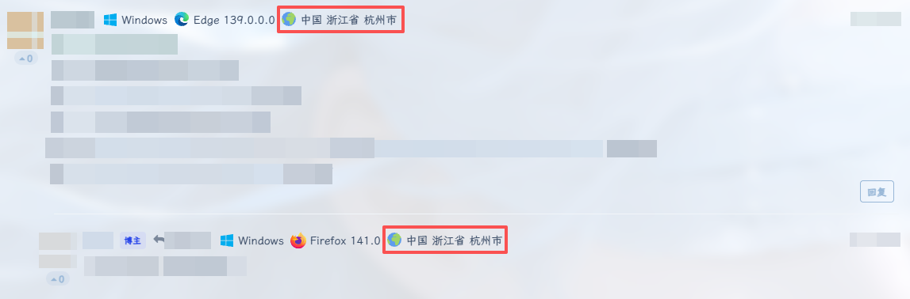
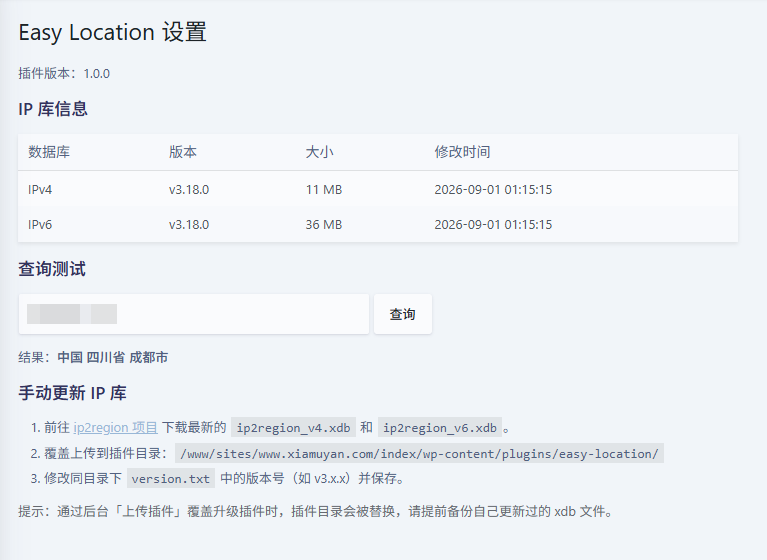

# Easy Location

> 在 [Argon](https://github.com/solstice23/argon-theme) 主题评论区显示访客 IP 归属地的 WordPress 插件，基于 [ip2region](https://github.com/lionsoul2014/ip2region) 离线库，不调用任何外部接口。

 

 

## ✨ 功能

- 🌏 评论 UA 信息后追加「地球图标 + 归属地」（国家 / 省份 / 城市）
- 📦 纯离线查询，无第三方 API、无网络请求
- 🔀 自动识别 IPv4 / IPv6 并选用对应数据库
- 🛠 后台「设置 → Easy Location」查看库文件状态、在线测试查询
- 🔒 只展示归属地，不公开完整 IP；自动向「隐私政策指南」添加说明

## ⚠️ 适用范围

**仅适用于 Argon 主题**。插件依赖 Argon 提供的 `argon_comment_ua_icon` 过滤器，其他主题下不会生效（后台会给出提示）。

## 📥 安装

1. 前往 [Releases](https://github.com/qimengcat/easy-location) 下载最新的 `easy-location-vX.X.X.zip`
2. WordPress 后台 → 插件 → 安装插件 → 上传插件 → 选择 zip → 安装并启用
3. 进入「设置 → Easy Location」确认 IPv4 / IPv6 库状态正常

> 请不要使用 GitHub 页面上的 “Code → Download ZIP”，那样得到的目录名会带 `-main` 后缀。

## 📁 目录结构

```
easy-location/
├── easy-location.php          # 插件主文件
├── readme.txt                 # WordPress 标准说明
├── version.txt                # 当前 xdb 数据库版本号
├── ip2region_v4.xdb           # IPv4 数据库
├── ip2region_v6.xdb           # IPv6 数据库
└── ip2region/
    ├── LICENSE                # ip2region 许可证（Apache-2.0）
    └── xdb/
        └── Searcher.class.php # ip2region PHP 查询类
```

## 🔄 更新 IP 库

1. 从 [ip2region](https://github.com/lionsoul2014/ip2region) 下载最新的 `ip2region_v4.xdb`、`ip2region_v6.xdb`
2. 覆盖上传到 `wp-content/plugins/easy-location/`
3. 修改 `version.txt` 中的版本号

> 通过后台上传 zip 升级插件时，插件目录会被整体替换，请提前备份自己更新过的 xdb 文件。

## ❓ 常见问题

**没有显示归属地？**
确认主题为 Argon；在设置页检查库文件；本地环境的 `127.0.0.1` 等内网 IP 无法解析。

**会不会拖慢页面？**
同一请求内相同 IP 只查询一次，查询基于本地文件，开销很小。

## 🔐 隐私说明

插件会公开显示评论者 IP 的大致归属地。启用后建议在站点隐私政策中说明（插件已在「设置 → 隐私 → 政策指南」中提供参考文字）。

## 🙏 致谢

- [ip2region](https://github.com/lionsoul2014/ip2region) by lionsoul2014 — 离线 IP 数据与查询类库（Apache-2.0）
- [Argon](https://github.com/solstice23/argon-theme) by solstice23

## 📄 许可证

本插件基于 [GPL-3.0-or-later](LICENSE) 发布。`ip2region/` 目录下的代码与 xdb 数据遵循其 [Apache-2.0](ip2region/LICENSE) 许可证。

## 📝 更新日志

### 1.0.0
- 首次发布
